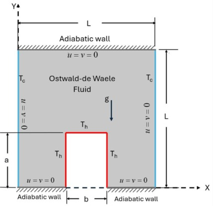
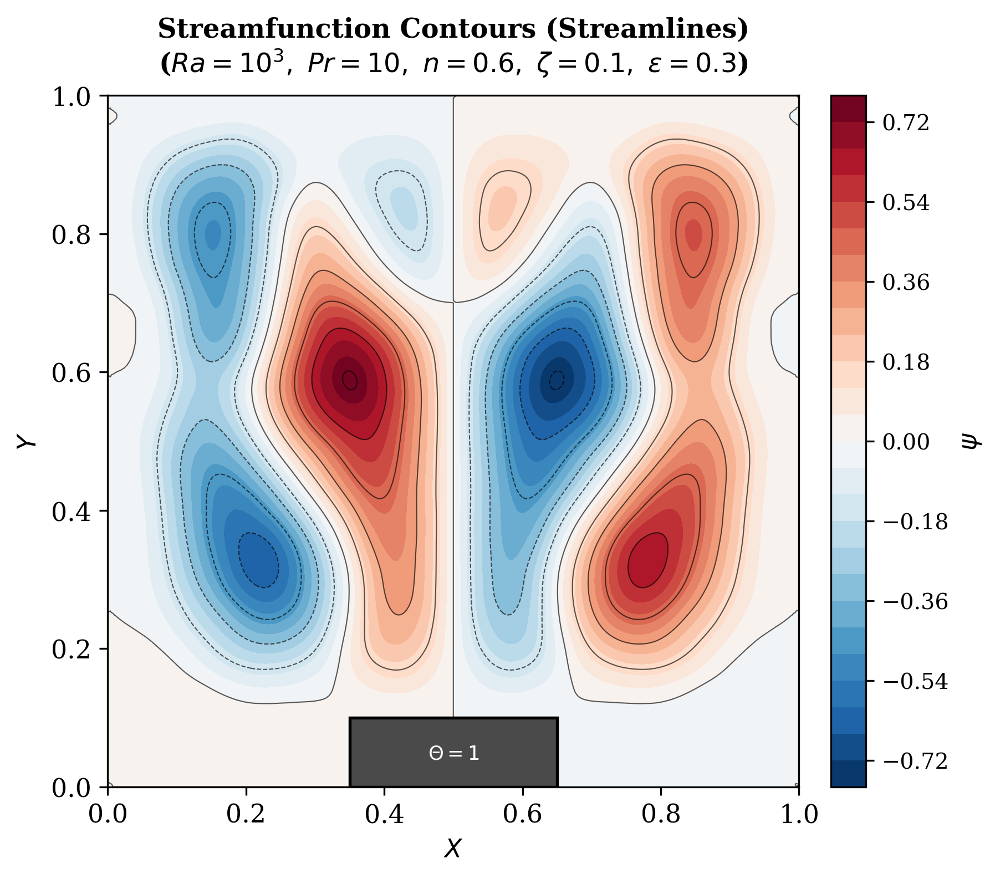
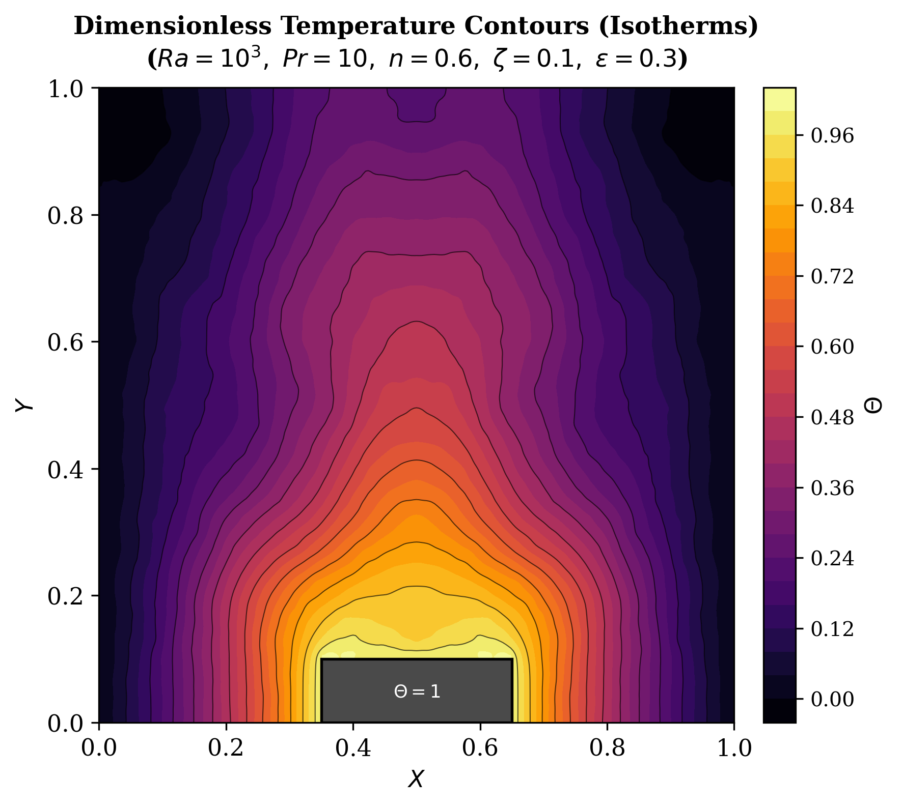
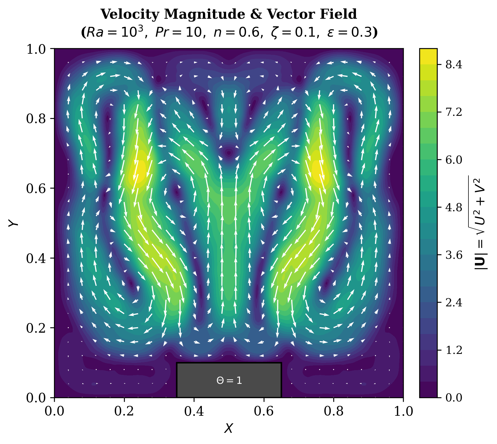

# Investigating the Behaviour of a 3-Heated-Strip Cavity Using an Advanced Physics-Informed Neural Network (PINN)

[](https://www.python.org/)
[](https://pytorch.org/)
[](#)
[](LICENSE)

## Overview

This repository presents a **100% data-free, hard-constrained Physics-Informed Neural Network (PINN)** framework for solving 2D steady-state laminar natural convection of a shear-thinning **Ostwald–de Waele power-law fluid** ($n = 0.6$, $Pr = 10.0$) inside a square enclosure containing a centrally located bottom protruding **$\Pi$-shaped heated strip** (three active heated faces) at Rayleigh number $Ra = 10^3$[cite: 20].

Unlike conventional soft-penalty PINNs that suffer from mass leakage and corner temperature rounding near non-convex boundaries, this architecture embeds **exact mass conservation**, **exact Dirichlet boundary conditions**, and **exact $X = 0.5$ mirror symmetry** directly into the neural network ansatz—requiring **zero interior FEM/CFD training data**[cite: 20].

---

## Domain Geometry & Exact Strip-Length Formulation

<p align="center">
  
</p>

In the dimensionless unit square cavity $[0, 1] \times [0, 1]$ with a centrally positioned bottom protruding $\Pi$-shaped heated strip of dimensionless width $\varepsilon = 0.3$ and dimensionless height $\zeta = 0.1$[cite: 20]:

* **Horizontal Strip Coordinates ($X$-axis bounds):**
  $$x_L = \frac{1 - \varepsilon}{2} = \frac{1 - 0.3}{2} = 0.35, \qquad x_R = \frac{1 + \varepsilon}{2} = \frac{1 + 0.3}{2} = 0.65$$
[cite: 20]
  The horizontal top heated face spans $X \in [x_L, x_R]$ of length:
  $$a = \varepsilon = x_R - x_L = 0.30$$
[cite: 20]

* **Vertical Strip Coordinates ($Y$-axis bounds):**
  The two vertical heated sidewalls at $X = x_L$ and $X = x_R$ span $Y \in [0, \zeta]$ of height:
  $$b = \zeta = 0.10$$
[cite: 20]

* **Total Active Heated Perimeter ($P_{\text{strip}}$) & Re-Entrant Corners:**
  $$P_{\text{strip}} = a + 2b = \varepsilon + 2\zeta = 0.30 + 2(0.10) = 0.50$$
[cite: 20]
  The two $270^\circ$ non-convex re-entrant geometric corners are located at $(x_L, \zeta) = (0.35, 0.10)$ and $(x_R, \zeta) = (0.65, 0.10)$[cite: 20].

### Boundary Conditions Summary
| Boundary Segment | Coordinates | Hydrodynamic BC | Thermal BC | Enforcement Method |
| :--- | :--- | :---: | :---: | :--- |
| Left & Right Vertical Walls | $X = 0, \; X = 1$ | $U = V = 0$ | $\Theta = 0$ (Cold) | **Hard Architectural Lifting**[cite: 20] |
| $\Pi$-Strip Left & Right Faces | $X = 0.35, 0.65, \; Y \in [0, 0.1]$ | $U = V = 0$ | $\Theta = 1$ (Hot) | **Hard Architectural Lifting**[cite: 20] |
| $\Pi$-Strip Top Face | $X \in [0.35, 0.65], \; Y = 0.1$ | $U = V = 0$ | $\Theta = 1$ (Hot) | **Hard Architectural Lifting**[cite: 20] |
| Top Cavity Wall | $Y = 1, \; X \in [0, 1]$ | $U = V = 0$ | $\partial \Theta / \partial Y = 0$ | Hard No-Slip + Soft Neumann[cite: 20] |
| Bottom Adiabatic Segments | $Y = 0, \; X \in [0, 0.35] \cup [0.65, 1]$ | $U = V = 0$ | $\partial \Theta / \partial Y = 0$ | Hard No-Slip + Soft Neumann[cite: 20] |

---

## Core Architectural & Optimization Methodology

1. **Exact Divergence-Free Streamfunction Formulation ($\psi$):**
   Velocity components are obtained via automatic differentiation as $U = \partial \psi / \partial Y$ and $V = -\partial \psi / \partial X$, satisfying $\nabla \cdot \mathbf{u} \equiv 0$ to machine precision without a continuity loss term[cite: 20].
2. **Hard No-Slip & Matched-Scale Transfinite Dirichlet Lifting:**
   * **Velocity:** $\psi(X, Y) = \psi_{\text{scale}} \, D_{\text{vel}}^2(X, Y) \, \hat{\psi}(X, Y)$ enforces $U = V = 0$ identically on all outer walls and all three $\Pi$-strip surfaces[cite: 20].
   * **Temperature:** $\Theta(X, Y) = \frac{d_{\text{cold}}}{d_{\text{cold}} + d_{\text{strip}}} + (d_{\text{cold}} \, d_{\text{strip}}) \, \hat{\Theta}_{\text{corr}}(X, Y)$ enforces $\Theta = 0$ on the cold sidewalls and $\Theta = 1$ on all three $\Pi$-strip faces, eliminating corner rounding at $(0.35, 0.10)$ and $(0.65, 0.10)$[cite: 20].
3. **Exact $X = 0.5$ Mirror-Symmetry Parity:**
   Evaluating paired inputs $(X, Y)$ and $(1 - X, Y)$ enforces odd parity $\psi(X, Y) = -\psi(1 - X, Y)$ and even parity $\Theta(X, Y) = \Theta(1 - X, Y)$, guaranteeing $Nu_L \equiv Nu_R$[cite: 20].
4. **Dual-Band Fourier Feature Embeddings & Modified MLP:**
   Low-frequency ($\sigma_{\text{low}} = 2.0$, 12 modes + deterministic fundamental harmonics) and high-frequency ($\sigma_{\text{high}} = 12.0$, 10 modes) Fourier embeddings feed a 4-layer gated Modified MLP (`hidden_dim = 96`) to capture sharp boundary layers around the re-entrant corners[cite: 20].
5. **Non-Newtonian Ostwald–de Waele Regularization & Hybrid Training:**
   Apparent viscosity $\mu^* = (\dot{\gamma}^2 + \epsilon_{\text{reg}})^{(n-1)/2}$ prevents singular viscosity divergence in low-shear vortex cores[cite: 20]. Training combines **3,000 Adam epochs** (with Residual-Based Attention, decoupled GradNorm, and global energy-flux conservation) followed by **500 Strong-Wolfe L-BFGS iterations**[cite: 20].

---

## Simulation Parameters & Benchmark Results ($Ra = 10^3$)

### Physical & Geometric Parameters
| Parameter | Symbol | Value | Description |
| :--- | :---: | :---: | :--- |
| Rayleigh Number | $Ra$ | $10^3$ | Buoyancy-to-viscous force ratio[cite: 20] |
| Prandtl Number | $Pr$ | $10.0$ | Momentum-to-thermal diffusivity ratio[cite: 20] |
| Power-Law Index | $n$ | $0.6$ | Shear-thinning Ostwald–de Waele fluid[cite: 20] |
| Strip Horizontal Width | $a = \varepsilon$ | $0.30$ | Spans $X \in [0.35, 0.65]$[cite: 20] |
| Strip Vertical Height | $b = \zeta$ | $0.10$ | Spans $Y \in [0.00, 0.10]$[cite: 20] |
| Active Heated Perimeter | $P_{\text{strip}}$ | $0.50$ | $a + 2b = \varepsilon + 2\zeta$[cite: 20] |

### PINN vs. COMSOL Multiphysics 6.3 Benchmark ($Ra = 10^3, n = 0.6$)
| Metric | Pure Data-Free Hard-BC PINN | COMSOL FEM Benchmark | Notes |
| :--- | :---: | :---: | :--- |
| **Domain-Average Temperature ($\Theta_{\text{avg}}$)** | **0.3049** | **~0.297** | **~2.6% relative deviation (100% data-free)** |
| **Left Strip Nusselt ($Nu_L$)** | **3.926** | Symmetric | Exact mirror parity ($Nu_L \equiv Nu_R$) |
| **Right Strip Nusselt ($Nu_R$)** | **3.926** | Symmetric | Exact mirror parity ($Nu_L \equiv Nu_R$) |
| **Top Strip Nusselt ($Nu_T$)** | **2.466** | — | Fluid-side offset quadrature[cite: 20] |
| **Average Nusselt ($Nu_{\text{avg}}$)** | **3.4395** | — | Conduction-dominated regime |
| **RMS Vertical Velocity ($V_{\text{rms}}$)** | **2.846** | — | Evaluated on 8,000 uniform interior points[cite: 20] |
| **Continuity Residual ($\Vert{}\nabla \cdot \mathbf{u}\Vert{}_\infty$)** | **$0$ (Exact)** | Mesh-dependent | Enforced analytically via streamfunction $\psi$[cite: 20] |

---

## Flow & Thermal Field Visualizations ($Ra = 10^3, n = 0.6$)

| Streamfunction Contours ($\psi$) | Dimensionless Isotherms ($\Theta$) | Velocity Magnitude ($\Vert{}\mathbf{u}\Vert{}$) |
| :---: | :---: | :---: |
|  |  |  |

---

## Repository Structure & Artifacts

```text
├── ra1e3_code.py                         # Complete PyTorch training & evaluation pipeline (Seed = 42)
├── requirements.txt                      # Python dependencies
├── figures/
│   ├── domain_schematic.jpeg             # Dimensionless geometry & boundary conditions schematic
│   ├── ra1e3_streamfunction_psi.png      # Converged streamfunction contours at Ra = 10^3
│   ├── ra1e3_temperature_theta.png       # Converged isotherm contours at Ra = 10^3
│   └── ra1e3_velocity_magnitude.png      # Converged velocity magnitude contours at Ra = 10^3
└── pinn_results/
    ├── pure_hardbc_ra1e3.pt              # Converged PyTorch model weights (state_dict)
    └── cavity_fields_ra1e3.npz           # 251 x 251 uniform evaluation grids (X, Y, U, V, P, Theta, psi)
```

---

## Quick Start & Usage

### 1. Train & Evaluate from Scratch
```bash
pip install -r requirements.txt
python ra1e3_code.py
```

### 2. Load Pre-Trained Weights & $251 \times 251$ Field Archive
```python
import numpy as np
import torch
from ra1e3_code import SymmetricHardBCPINN

# Load converged model weights
device = torch.device("cuda" if torch.cuda.is_available() else "cpu")
model = SymmetricHardBCPINN(hidden_dim=96).to(device)
model.load_state_dict(torch.load("pinn_results/pure_hardbc_ra1e3.pt", map_location=device))
model.eval()

# Load pre-computed 251 x 251 solution arrays
data = np.load("pinn_results/cavity_fields_ra1e3.npz")
X, Y = data["X"], data["Y"]
U, V, P = data["U"], data["V"], data["P"]
Theta, psi = data["Theta"], data["psi"]
```